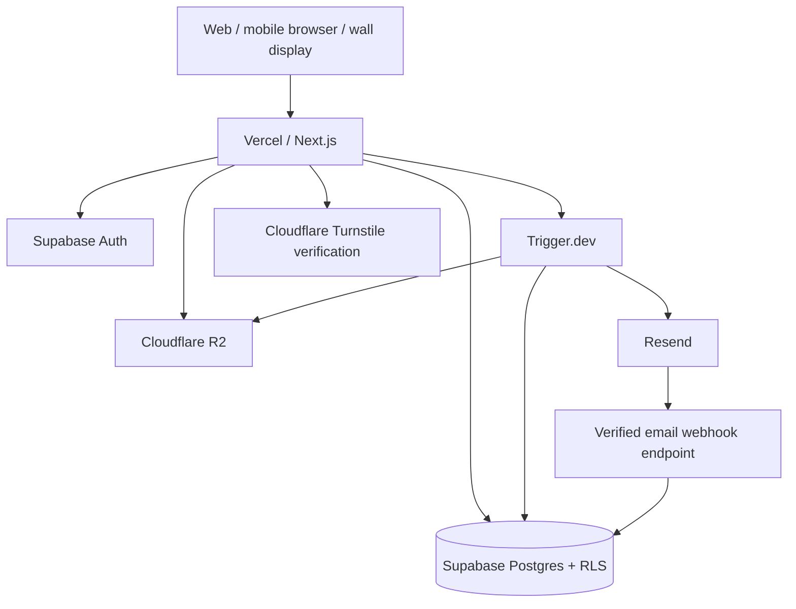

# Madeora — Technical Architecture

**Status:** Claude implementation baseline. Explicitly approved choices are binding; recommendations and open questions are not.  
**Last updated:** 2026-10-13  
**Authority:** "The product specification" means the fixed, READ-ONLY set `Project-entry.md` (read first), `Modules.md` and `Project-specification.md` (binding detailed requirements). It defines product behavior and requirements. **Everything in the product specification is MVP.** This document defines implementation choices; it must not silently redefine product requirements. Where it records a *sequencing* decision (a spec capability built later within the MVP), that capability remains required.

**Read this first:** The MVP is a **Next.js App Router application built with React** (not a separate React SPA). The product specification is the read-only product authority. This document is the technical source of truth; `CLAUDE.md` defines agent workflow. During development **spend €0** and do not activate billing or paid features without explicit owner approval.

## 1. Architectural principles

- TypeScript end-to-end, strict typing, explicit domain boundaries.
- Modular monolith first; avoid microservices until justified by operational evidence.
- Server-side authorization, defense in depth, tenant isolation, secure defaults.
- Separate *global account identity* from *per-Home membership/profile presentation*; never confuse an avatar, name, or accent color with an authorization identity.
- Support desktop, mobile, and wall-display experiences with accessibility and privacy built in.
- Keep infrastructure portable through adapters where feasible, without overengineering.
- Favor simple, observable, tested flows over speculative abstractions.
- All substantive architecture changes require a documented ADR and owner approval.

## 2. Approved stack and decision status

**Approved (2026-10-13):** Turborepo monorepo with pnpm workspaces from day one; web MVP in Next.js; full-featured native iOS and Android applications planned **post-MVP**, not companion apps and not part of MVP delivery; hybrid API strategy combining Supabase Auth/Postgres/RLS/realtime where justified with an application API for complex operations, integrations and privileged workflows; **database access strategy A: official Supabase client exclusively**, with no additional ORM; **realtime strategy C: selective Supabase Realtime** for collaborative, time-sensitive views only; **data fetching and caching strategy B: Next.js + TanStack Query** for interactive client-side server state; **authentication strategy A: Supabase Auth with official `@supabase/ssr` integration** for Next.js and platform-specific session handling for future Expo clients; **background processing strategy B: Trigger.dev for durable, scheduled, retryable or long-running jobs; direct API execution for short synchronous operations**; **transactional email strategy A: Resend + React Email with version-controlled templates in a shared Turborepo package**; **forms and validation strategy A: React Hook Form + Zod**; **code quality strategy B: ESLint + Prettier + TypeScript strict mode**; **deployment environment strategy A: development, dedicated staging and production, with isolated PR previews**; **frontend state strategy A: Zustand for shared ephemeral UI state, React state for local UI state, and TanStack Query for server state**.

**Additional approved decisions (2026-10-13):** Tailwind CSS with fully custom components; Vitest + React Testing Library + Playwright; Vercel/Supabase/Trigger.dev native observability; €0 development spend; disposable development databases recreated from migrations and synthetic seeds; native Node.js development using verified free hosted services; Zod-validated typed environment configuration; next-intl; date-fns + date-fns-tz; React state + Zustand + TanStack Query; React Grid Layout; fully custom SVG icons; Motion for React + CSS transitions. Each is specified in its dedicated section below.

**Recommended, not yet approved:** Expo + React Native for post-MVP native apps; Next.js Route Handlers as the initial HTTP API deployment. Do not implement unapproved choices by assumption.


| Concern | Technology | Responsibility / notes |
| --- | --- | --- |
| App | Next.js (App Router), React, TypeScript | SSR, server components, route handlers, web app |
| Hosting | Vercel | Web deployment, preview deployments, environment separation |
| Database | Supabase Postgres | Canonical relational data; migrations in Git |
| Identity | Supabase Auth + `@supabase/ssr` | Official SSR cookie integration for Next.js; domain authorization remains in application/database |
| Authorization | PostgreSQL RLS + server policy layer | Defense-in-depth for per-Home boundaries and role permissions |
| File storage | Cloudflare R2 | Private uploads, media and attachments using S3-compatible API |
| Bot protection | Cloudflare Turnstile | Sensitive public forms / abuse-prone actions, validated server-side |
| Background jobs | Trigger.dev | Durable asynchronous tasks, retries, scheduled work |
| Transactional email | Resend + React Email | Resend delivers email; React Email templates live in Git in a shared Turborepo package |
| UI styling | Tailwind CSS + CSS variables | Approved strategy B: custom design tokens, responsive layouts, theme and personal accent handling |
| UI components | Fully custom Madeora React components | Built in-house with semantic HTML and accessible behavior; no shadcn/ui or default component kit |
| Forms | React Hook Form + Zod | Form handling, shared validation schemas where appropriate |
| Client server-state cache | TanStack Query (`@tanstack/react-query`) | Interactive client-side queries, mutations, invalidation and background refetch; usable in future Expo clients |
| Data access | `@supabase/supabase-js` exclusively | Typed user-scoped queries and `supabase.rpc()` for approved PostgreSQL functions; no Prisma/Drizzle/other ORM |
| Unit/integration tests | Vitest + Testing Library | Domain logic, components, service boundaries |
| E2E | Playwright | Key user journeys, permissions, responsive and wall-display checks |
| Quality | ESLint, Prettier, TypeScript strict | Static checks and formatting |
| Observability | Vercel, Supabase and Trigger.dev native monitoring + structured logs (approved B) | Platform-native diagnostics, correlated operational events and privacy-safe logging |
| Package manager | pnpm workspaces + Turborepo | Approved monorepo, lockfile, task graph and reproducible CI |
| Native mobile (post-MVP) | Expo + React Native (proposed) | Full-featured iOS/Android clients; no native mobile implementation in MVP |

**Owner sequencing decisions (2026-10-13):** Ora ships first **without a language-model provider or free-text input**; free text is added later after provider/budget approval (§32). **Google sign-in** is the only social sign-in built now; Sign in with Apple stays a spec requirement, deferred until the Apple Developer fee is approved (§7). **Children and Household Displays authenticate through Supabase Auth** (§7, §33, §34). **Cloudflare R2 is added when the first file-storing feature needs it** (§10).

**Required by the product specification (not open):** Google Calendar two-way sync (§31), Household Display pairing and identity (§33), guardian-managed child sign-in (§34), adult 2FA and recovery (§7, §35), data lifecycle and storage quotas (§36), photo processing (§37), recipe URL import (§38), in-app + email notifications (§39), offline-safe states (§40).

**Still open (not approved):** feature-specific Realtime refresh details, web push, analytics, app pricing/payments, installable PWA, search infrastructure, and production backup guarantees. Internationalization is **approved: next-intl**. See the final Open Decisions section; do not treat suggestions as decisions.

## 3. High-level system diagram



**Trust boundary:** The browser is untrusted. All sensitive reads/writes, storage access, job initiation and cross-Home actions must be authenticated and authorized on the server. Webhooks are verified and idempotent.

## 4. Domain model and tenancy

Proposed foundational concepts (validate against the current product specification before schema implementation):

- `users` / Supabase Auth users: one global login identity per account.
- `user_preferences`: global display preferences, including personal dashboard accent.
- `homes`: isolated collaboration contexts.
- `home_memberships`: association between a user and a Home, role/status, joined/left timestamps.
- `home_member_preferences`: optional per-Home display name, avatar and accent overrides, subject to product permissions.
- `child_profiles`: decided by the spec — a guardian creates a child with **no email**; one child identity across Homes; one or two guardians (primary/secondary); dashboard access and independent sign-in are separate guardian-controlled switches, both off by default. When sign-in is enabled the child gets a Supabase Auth user (§34). Age thresholds remain open.
- `audit_events`: who did what, in which Home, to which resource, and when; identity stored by stable IDs, not color or display name.
- Module-specific tables should reference `home_id` and stable actor/subject IDs as applicable.

**Non-negotiable:** Home A data must never be accessible through Home B context. An account's global identity must not leak private per-Home details. Duplicate accent colors are allowed; names/icons must remain visible and accessibility warnings are UI guidance, not uniqueness constraints.

### Approved authorization strategy C — RLS + centralized permission engine (2026-10-13)

- **Database boundary:** Supabase PostgreSQL RLS must independently protect every client-accessible table, view, function and realtime publication. Enforce Home membership, resource ownership and required row/action restrictions; default deny. No direct Supabase operation may rely on a TypeScript-only check for its security.
- **Central policy engine:** Implement a shared, server-safe TypeScript authorization module with explicit, typed actions, resources, actor/Home context, role/capability resolution and child/guardian rules sourced from approved product requirements. Centralize policy evaluation; avoid duplicated route-specific role logic and UI-only enforcement.
- **Execution boundary:** API routes and server operations verify identity, current Home membership and capability before mutations, external effects, privileged credentials, R2 signatures or background job scheduling. Use the acting user's Supabase session and RLS by default; privileged bypass is exceptional, narrowly scoped, and audited.
- **Shared contracts:** Client code may use a safe permission projection for UI affordances, but this is never authoritative. Do not export privileged policy internals or credentials to browser/mobile packages.
- **Revocation and caching:** Re-evaluate permissions for sensitive actions; invalidate cached capability projections and protected data on membership, role, guardian or Home changes. Scope Realtime channels and cache keys accordingly.
- **Policy parity:** Where direct access is allowed, encode equivalent restrictions in RLS or restricted database RPCs. If a rule cannot be safely enforced there, require the operation to go through the authorized server API. Avoid security-definer RPCs unless reviewed, narrowly scoped and tested.
- **Verification:** Unit-test the policy decision matrix; integration-test RLS as multiple authenticated actors; add cross-Home, forged-ID, revoked membership, role escalation, guardian and service-role bypass regression tests. Review policy and migration changes as security-sensitive.
- **Product authority:** Canonical roles, permissions, guardian rules and wall-display capabilities come from the read-only product specification; do not invent them in technical implementation. Decided there: exactly one **Owner** per Home (atomic transfer only), **Administrators** with Owner-delegated capabilities, **Members**, **configurable per-module permissions in the MVP**, one or two guardians per child, and Household Displays as a separate non-member identity. The exact per-module permission matrix is still open.

### Authorization approach

1. Authenticate the request and resolve the current Home context.
2. Authorize the operation using explicit role/capability policy, including child/guardian rules.
3. Query using scoped predicates and RLS; never trust a client-supplied `home_id` alone.
4. Check resource ownership and cross-Home references on writes.
5. Audit sensitive operations and permission changes.
6. Test malicious and accidental cross-Home access at API, service, and database levels.

Never expose the Supabase service-role key to the browser. Use privileged credentials only in narrowly scoped trusted server contexts, with explicit application-level authorization before bypassing RLS.

## 5. Monorepo and hybrid API boundaries

Approved repository direction (create only packages with a current purpose; do **not** scaffold an empty mobile app during MVP):

```text
madeora/
  apps/
    web/                  # Next.js App Router, web MVP, responsive and wall displays
    mobile/               # Planned post-MVP: Expo/React Native (not created in MVP)
  packages/
    contracts/            # Transport-safe versioned API types and schemas
    domain/               # Framework-agnostic domain types and pure rules
    validation/           # Shared Zod schemas where safe for client use
    design-tokens/        # Cross-platform design tokens, not assumed shared UI
    config/               # Shared lint/TypeScript/build configuration
  supabase/migrations/    # Versioned schema and RLS policies
  tests/e2e/              # Playwright
  docs/adr/               # Architecture decision records
  .github/workflows/      # CI and release pipelines
  docs/product/           # Project-entry.md, Modules.md, Project-specification.md — READ ONLY, NEVER MODIFY (committed; CODEOWNERS + CI guard fail any PR that changes them)
  architecture.md
  CLAUDE.md
  pnpm-workspace.yaml
  turbo.json
```

**Hybrid API rules:**

- Supabase Auth manages identity and sessions; Postgres and RLS enforce data isolation. Selective Supabase Realtime is approved; enable it only for product-justified collaborative views.
- The web app may use user-scoped Supabase reads/writes directly **only** when RLS and server-side validation enforce all applicable invariants. Do not expose service-role credentials to clients.
- Complex mutations, privileged operations, R2 signing, Trigger.dev dispatch, Resend delivery and integrations go through an authenticated, authorized application API.
- Start with Next.js Route Handlers for HTTP endpoints (proposed), under stable versioned routes such as `/api/v1/...`; do not make future mobile clients depend on server actions or Next.js-specific session assumptions.
- Keep business logic in server-only services behind route handlers; route handlers validate inputs, resolve the acting user/Home, authorize, invoke services, and serialize typed responses.
- Use shared transport contracts for future mobile interoperability; never import server-only code into client or React Native packages.
- Prefer explicit, documented API contracts and backward-compatible evolution. Version breaking changes and maintain a mobile-client compatibility policy before native release.
- RLS and server authorization must agree; test both, especially cross-Home and child/guardian access.
- Wall displays remain part of the web app unless later evidence supports a separate deployment.

## 6. Database and migration strategy

**Approved database access strategy A:** All application-level PostgreSQL access uses the official Supabase client (`@supabase/supabase-js`), including server-side operations. Do not introduce Prisma, Drizzle, direct `pg` clients, or another ORM/query builder for application database access without a new explicit architecture approval.

- Generate TypeScript database types from the Supabase schema and use typed clients for queries and RPC calls.
- Use `supabase.rpc()` to invoke narrowly scoped PostgreSQL functions for atomic multi-step operations that cannot safely be implemented as separate client calls. Review function privileges and `SECURITY DEFINER` search paths carefully; grant execution only to appropriate roles.
- SQL is permitted for version-controlled migrations, RLS policies, constraints, indexes, database functions, and database-level tests; "client exclusively" does not prohibit SQL at the database definition level.
- In trusted server contexts, use the acting user's authenticated Supabase session by default to preserve RLS. Elevated credentials are exceptional, server-only, and require explicit authorization and auditability.
- Never implement a multi-step invariant as several non-atomic client mutations when partial completion would corrupt data.

- PostgreSQL is the system of record; no business-critical state solely in browser storage.
- Use SQL migrations committed with the feature branch; never manually change production schema without a migration.
- Every tenant-scoped table must have a documented RLS strategy and tests.
- Add appropriate indexes and uniqueness constraints, scoped by Home where relevant.
- Store timestamps in UTC; format using the intended Home/user timezone.
- Prefer transactional writes for multi-record invariants; enforce important constraints in DB.
- Backward-compatible migrations for deploys: expand → deploy → backfill → contract.
- Document backup, point-in-time recovery availability, restore drills, retention and data deletion before production launch.
- Use separate development, preview/test, and production environments; do not share production data with preview deployments.

## 7. Authentication and sessions — approved strategy A

**Decision (2026-10-13):** Use **Supabase Auth + official `@supabase/ssr` integration** for Next.js. Do not introduce a second identity provider or a custom application session/token system without explicit approval.

- Use `@supabase/supabase-js` and `@supabase/ssr` in the appropriate browser/server contexts. Centralize client factories; follow the current official Supabase SSR cookie-refresh guidance and verify compatibility with the installed Next.js version.
- Treat cookies and bearer tokens as credentials, not as proof of current Home membership or permissions. For sensitive server operations, validate the authenticated identity with `supabase.auth.getUser()` or the current officially recommended verified-claims approach; do not authorize from unverified `getSession()` user data.
- Enforce Home-scoped authorization separately using database RLS and server policy checks. Session identity is global; Home profile overrides never create a second identity.
- Apply secure cookie attributes, CSRF protections appropriate to cookie-authenticated mutation endpoints, safe redirects, login throttling/abuse controls, and least-privilege secrets. Never expose service-role credentials to the client.
- On sign-out, account switching, expired/revoked sessions, or Home permission changes, clear sensitive TanStack Query caches, release Realtime subscriptions, and revalidate server access.
- Protect SSR from cross-user caching; never publicly cache responses containing personalized authenticated data. Test session refresh, multi-tab sign-out, expiry, and SSR/client hydration.
- For post-MVP Expo apps, use Supabase Auth with platform-appropriate secure session storage and deep-link/redirect handling. Do not implement or scaffold mobile authentication during the MVP.
- **Decided sign-in methods (product specification + owner sequencing, 2026-10-13):**
  - Adults: verified **email + password** and **Sign in with Google** (Supabase Auth providers). Link/unlink one Google identity from Account Settings; never auto-link on matching email; block removing the last usable method. **Passkeys are out of scope.**
  - **Sign in with Apple** is required by the spec but **deferred**: it needs a paid Apple Developer Program membership, which conflicts with the €0 rule. Do not build it until the owner approves the fee; keep account/identity tables provider-agnostic so it can be added without migration pain.
  - Optional adult **TOTP 2FA** via Supabase Auth MFA. Madeora-owned **recovery codes** (TOTP recovery codes and separate account recovery codes) and a verified **backup email** are custom server features: store only hashed verifiers, rate-limit, audit, never show again.
  - **Children and Household Displays use Supabase Auth too** — no second session system. Each gets a Supabase user with an internal, non-deliverable email alias that is never shown or mailed. Child username/PIN/password and display pairing are verified by Madeora server code, which then issues the Supabase session. A PIN is never an internet-facing credential (approved devices only). See §33 and §34.
  - Invitation acceptance follows the spec's invitation sections (email/link/code, account matching, resend/renewal); remaining edge cases are listed in Open decisions.


## 8. Realtime synchronization — approved strategy C

**Decision (2026-10-13):** Use **selective Supabase Realtime** rather than global subscriptions or polling-only synchronization. Realtime is an enhancement to authoritative database reads, not a substitute for them.

- Subscribe only while a screen or active feature needs timely shared updates (for example, an actively displayed shared board or wall display, if its product requirements warrant it). Do **not** subscribe globally to every table, Home or module.
- Scope every channel, filter and payload to the authenticated user and authorized Home. Enforce authorization in database RLS and any Realtime-specific policies; channel names, client filters and hidden UI are **not** security boundaries. Never expose other Homes' activity through broadcast/presence payloads.
- Perform initial authoritative fetch, then subscribe to relevant changes; refetch or invalidate affected queries when events arrive. Handle the initial-fetch/subscribe race with a documented reconciliation approach, rather than assuming events cannot be missed.
- Mutations remain authoritative server/database operations. Optimistic UI, if used, must reconcile on success/failure and must never imply an unauthorized or uncommitted change succeeded.
- On reconnect, browser resume, token refresh, subscription error or dropped event, revalidate membership and refetch authoritative state. Do not assume guaranteed delivery, ordering or durable event replay.
- Release subscriptions when leaving the view, changing Home or signing out. Avoid duplicate subscriptions and connection leaks, especially on long-running wall displays.
- Use ordinary reads and targeted refresh for infrequently changing screens; add a bounded fallback refresh strategy only where needed for reliability. Do not invent a universal polling interval without usage evidence.
- Choose between Postgres Changes and authorized Broadcast per feature based on scale, data exposure and delivery needs; avoid broadcasting sensitive row contents unnecessarily. Document the choice and test cross-Home isolation, child/guardian permissions, reconnect behavior and resource consumption.
- No new product features or MVP scope are implied by this infrastructure decision. Consult the product specification before identifying screens that require realtime. **Candidates justified by the spec:** Household Displays (long-running, shared), shared shopping-list item completion, the unassigned chore pool (first-come claims), shared Home dashboards, and approval queues. Each still needs a per-feature decision on mechanism, scope and reconnect behavior.

## 9. Data fetching and caching — approved strategy B

**Decision (2026-10-13):** Combine Next.js App Router server rendering with **TanStack Query** for interactive client-side server state. Supabase `@supabase/supabase-js` remains the **only database client**; TanStack Query is a cache/orchestration layer, not an ORM or alternate database interface.

- Use React Server Components and server-side Supabase reads for initial rendering where beneficial. Use TanStack Query in client components for interactive reads, loading/error/retry states, mutations, cache invalidation and background refetch.
- Centralize stable, typed query keys; include user and Home identity where relevant. On sign-out, Home switching, membership/permission changes or session transitions, remove or invalidate sensitive cached data so it cannot appear under another context.
- Never use query caches as an authorization boundary. Enforce Supabase RLS and server API authorization on every underlying request; do not put service-role credentials or privileged functions in browser bundles.
- Integrate selective Supabase Realtime by invalidating/refetching the affected TanStack queries (or carefully updating cache only where proven safe). Reconcile after reconnect, tab resume and subscription gaps; realtime messages are not authoritative database state.
- Choose `staleTime`, garbage collection, retry behavior, pagination, prefetching and optimistic updates per feature based on data sensitivity and user experience. Do not apply a blanket aggressive polling interval. Roll back failed optimistic mutations and reconcile with server state.
- Keep server-side and client-side caches distinct. Do not globally cache personalized Home data or accidentally reuse SSR hydration across users. Document Next.js cache/revalidation behavior explicitly for any authenticated server read.
- Share query key conventions, contracts and framework-neutral data access functions across apps where useful. React Query hooks may be shared when platform-neutral, but native Expo clients remain post-MVP.
- Test cache isolation across accounts/Homes, permission revocation, mutation failure and rollback, realtime invalidation, reconnect/refetch, stale data, and SSR hydration without data leaks.

## 10. Media and storage — approved strategy B

**Sequencing (owner, 2026-10-13):** add R2 **when the first file-storing feature needs it** (avatars, task attachments, photos, recipe covers or exports), not during bootstrap. If R2 then requires a payment card or billing activation, stop and ask the owner (§23).

**Decision:** Use **private Cloudflare R2 with signed direct uploads and authorized downloads** for user-generated content. The application API controls issuance of short-lived presigned URLs; clients transfer file bytes directly to R2 rather than proxying through Vercel. This applies to the web MVP and is compatible with full-featured post-MVP Expo apps. No public access to private household media.

### Upload lifecycle

1. Authenticated client requests an upload intent from the application API, supplying the Home/resource context, declared MIME type, size and relevant metadata.
2. API validates session, current Home membership and upload capability using the centralized permission engine; checks quotas, file type/size policy and resource ownership. Never accept client-selected arbitrary bucket or object keys.
3. API creates a short-lived pending upload record in Supabase PostgreSQL, generates a random opaque R2 object key scoped to the correct storage namespace, and returns a short-lived **operation-specific** presigned PUT URL (or multipart upload instructions where approved). Bind allowed content type/checksum and size where supported; independently verify actual uploaded object metadata afterward. A signed PUT URL by itself is not a reliable file-size enforcement mechanism.
4. Client uploads directly to private R2 over HTTPS using configured, narrowly scoped bucket CORS. Do not send R2 credentials to browsers/mobile clients. Upload credentials/URLs must not appear in logs or analytics.
5. Client calls a finalize endpoint. Server verifies object existence, actual size, content type and integrity; validates file signatures, runs scanning/processing when required, and marks the metadata record ready only after checks succeed. Files remain unavailable to other users while pending/quarantined.
6. Expired intents, abandoned multipart uploads and orphaned objects are cleaned up by an idempotent scheduled job, with safeguards against deleting live objects.

### Download lifecycle

- For every download, the API authenticates the requester and checks *current* Home/resource access, then issues a short-lived **GET-only** presigned URL. Do not rely on possession of object keys, metadata visibility or prior membership for authorization.
- A presigned URL is a bearer capability until expiry: revoking membership does not revoke an already-issued URL. Use short expiry and, where immediate revocation is a product requirement, serve via an authorization-enforcing gateway rather than direct presigned GET.
- Use safe `Content-Disposition`/content-type handling; prevent executable or HTML content from being served inline on an application origin. Separate trusted processed previews from untrusted originals.

### Data model, processing and lifecycle

- PostgreSQL is the authority for file IDs, object keys, Home/resource ownership, creator, MIME, byte size, checksum, processing state, created/deleted timestamps and retention status. Never trust client-supplied ownership fields.
- Use private R2 buckets and least-privilege S3-compatible API credentials, rotated per environment; no public bucket domains or public ACLs for household content. Separate dev/staging/production storage and secrets.
- Define per-feature file type/size quotas and retention in product requirements; don't invent them. Image resizing, thumbnail generation, malware checks and EXIF stripping should be assessed per media type before exposure.
- File deletion should authorize first, tombstone metadata, remove derived objects and originals via retry-safe background jobs, and reconcile failed operations. Document backup/restore and GDPR deletion implications; R2 is not automatically a backup.
- Protect signing/finalization endpoints with rate limits, audit events, upload quotas and abuse controls. Test cross-Home access, forged keys, expired signatures, oversized or mismatched objects, incomplete uploads, concurrent deletion and access revocation.

## 11. Background processing and email

- **Approved strategy B (2026-10-13):** Trigger.dev handles durable, scheduled, retryable, long-running, or failure-sensitive background work (e.g. notifications, email orchestration, cleanup, file processing). Short, fast, synchronous operations run directly in the Madeora API when their completion belongs to the immediate request. Do not queue trivial operations by default.
- A request must not return success for a business operation that has not been durably committed. For workflows requiring a database write and job dispatch, use a transactional outbox or equivalent reliable handoff; document dispatch failure and recovery.
- Jobs re-check current authorization and relevant resource state at execution time where access may have changed since enqueueing. Never pass service-role secrets or raw session tokens in task payloads.
- Use typed, versioned, minimal job payloads, bounded retries, concurrency/rate limits and per-environment separation; log correlation IDs and expose actionable job status without leaking personal data.
- Each task must be idempotent or have a deduplication key; record delivery/state transitions in Postgres.
- Distinguish retryable failures from permanent validation/permission failures; use backoff and dead-letter/manual recovery processes.
- Resend handles transactional delivery. Verify webhook signatures; record message IDs and delivery outcomes.
- No email sending directly from arbitrary UI code; centralize templates, consent/preferences and suppression logic.
- Use the database as the source of truth for schedules and jobs that matter; account for timezones and DST.

### Approved transactional email strategy A — Resend + React Email (2026-10-13)

- Use **Resend** for delivery and **React Email** to implement version-controlled, typed, accessible email templates in a shared, server-safe Turborepo package (for example `packages/emails`). Keep templates and tests with the relevant code changes.
- Centralize template rendering, validated variables, sender identity, localization when required, delivery orchestration, and safe escaping. Include a plain-text alternative, accessible markup, and email-client compatibility tests/previews. Do not render arbitrary user HTML into messages.
- Send from trusted server code only. Use **Trigger.dev** for durable, retryable or scheduled delivery; simple synchronous sends may use the API only when the user-facing flow genuinely requires their immediate result. Ensure idempotency, bounded retries, and no duplicate delivery on repeated jobs or webhooks.
- Authenticate and verify Resend delivery webhooks, deduplicate events, and record provider message IDs and status transitions without logging sensitive content. Apply suppression, bounce/complaint handling, and approved user communication preferences. Essential security emails must follow product-approved rules rather than generic marketing preferences.
- Configure verified sending domains, SPF/DKIM/DMARC and separate environment credentials/domains. Never expose Resend API keys to clients.
- Test template rendering, missing/invalid variables, link safety, provider failures, duplicate events, and delivery status reconciliation. Define exact email types, copy, locale and retention from the read-only product specification; do not invent product flows.

## 12. Frontend styling and components — approved strategy B

- Use **Tailwind CSS and fully custom Madeora React components**. Do not install shadcn/ui or adopt a prebuilt component library as the design system.
- Build a small, documented, accessible component foundation using semantic HTML, React, CSS variables and Tailwind utilities. Use native browser controls when appropriate. A focused headless accessibility primitive may be proposed only for a specific difficult interaction, with owner approval; it must not dictate the visual design.
- Define design tokens for color, gradient accents, typography, spacing, radius, elevation, motion, breakpoints and light/dark appearance. Follow approved visual specifications from the product specification; do not invent product behavior or visual rules.
- Keep presentational components separate from data access and domain authorization. Reuse components only when a real second use exists; avoid speculative design-system complexity.
- Design and test responsive desktop/tablet/mobile-browser layouts and wall displays for the MVP. Native Expo apps are post-MVP; share platform-neutral design tokens where practical, not React DOM components.
- Require keyboard navigation, focus visibility, screen-reader labeling, contrast checks, reduced-motion support and accessible error/loading/empty/disabled states. Include component tests, automated accessibility checks and representative visual regression screenshots.

## 13. Forms and validation — approved strategy A

- Use **React Hook Form (`react-hook-form`) + Zod** for interactive web forms. Use `@hookform/resolvers/zod` where appropriate; keep the validation schema as the source of truth for input shapes and error mapping.
- Build forms with **Madeora's custom accessible UI components**, not a prebuilt visual component library. Prefer native inputs and uncontrolled registration where possible; use `Controller` only for controlled custom inputs that require it.
- Put reusable, platform-neutral Zod schemas in `packages/validation` when actually shared. Keep database/admin-only validation server-side; never ship server secrets or privileged schemas to browsers.
- **Always validate untrusted input on the server**, including API requests, actions, uploads, job payloads and callbacks. Browser validation is for UX, not security. Enforce authorization and business invariants separately; use PostgreSQL constraints for database integrity.
- Model required/optional/nullable values explicitly, normalize inputs safely, and display field-level plus form-level errors accessibly. Prevent accidental duplicate submissions and preserve user input on recoverable failures.
- Test valid/invalid inputs, cross-field constraints, async/server failures, keyboard navigation, focus-on-error, disabled/submitting states and schema compatibility between client and server.
- Future Expo applications may reuse **Zod contracts**, but their form/UI implementation is a post-MVP decision; do not assume DOM components are portable.

## 14. Frontend state management — approved strategy A

**Decision:** Use free open-source **Zustand + React state + TanStack Query** in the Next.js web MVP. Zustand is for genuinely shared **client-side UI state**; React `useState`/`useReducer` is for component-local state; TanStack Query remains the source of truth for **remote/server state**. Keep the mandatory **€0 development budget**.

- Use narrowly scoped, typed Zustand stores for cross-component transient UI interactions such as dashboard editing mode, selected widgets and panel state. Prefer local React state when sharing is unnecessary. Avoid a single global catch-all store and avoid premature persistence middleware.
- Keep account identity, Home membership, roles, permissions, private household records and other authoritative data in Supabase/application APIs and TanStack Query; **never treat Zustand as an authorization source** or duplicate mutable server entities in it.
- Persist preferences and dashboard configuration through approved authorized APIs and RLS; use TanStack Query mutations/invalidation. Keep unsaved edits explicitly separate from persisted server state, with clear save/cancel and conflict behavior per product specification.
- Scope UI state by active account, Home and display context when applicable. Reset relevant Zustand state and sensitive TanStack Query caches on logout, account/Home switch, membership revocation and session changes; prevent cross-Home state leaks. Do not persist sensitive UI data in localStorage/sessionStorage by default.
- Avoid server-rendering and hydration inconsistencies: create and consume stores safely with Next.js App Router; never share request-specific state through a process-global server store. Treat browser-only APIs as client-only.
- Use selectors and shallow comparison where helpful to avoid broad rerenders, and keep actions predictable and testable. Realtime events update/invalidate server state through TanStack Query, not by creating a parallel Zustand database.
- Test store actions and resets with Vitest, component interactions with React Testing Library, and Home switching, unsaved edits and permission/session transitions with Playwright. Do not add Redux, Jotai or another global state library without explicit approval.
- Future mobile state architecture is a post-MVP decision; reuse pure domain types where appropriate without presuming browser store implementations work unchanged in React Native.

## 15. Dashboard drag-and-drop — approved strategy B

**Decision:** Use the free, open-source **React Grid Layout** library for draggable, resizable dashboard widget grids in the Next.js web MVP. This supersedes the proposed dnd-kit/custom layout engine; do not install dnd-kit for dashboard placement without explicit approval. Preserve the mandatory **€0 development budget** and verify the selected package/version/license before adoption.

- Wrap React Grid Layout in a **Madeora-owned dashboard layout component** with custom Tailwind styling and design tokens. The library supplies layout mechanics, **not** Madeora's visual identity or product behavior.
- Keep a stable, versioned widget layout schema with widget IDs, grid coordinates, spans, minimum/maximum sizes and breakpoint-specific layouts where required. Validate incoming layouts with Zod and enforce bounds, collision rules, allowed widget types and product-specific constraints on the server.
- Follow approved product specifications for edit mode, drag handles, resize controls, save/cancel, mobile breakpoints and wall displays. Do not assume that every user can edit: enforce permissions in API and PostgreSQL RLS, not just by disabling controls.
- Provide accessible **non-drag alternatives** to move and resize widgets (e.g. explicit controls), keyboard operability, clear focus indicators and screen-reader announcements. Verify actual React Grid Layout accessibility; do not claim pointer dragging alone meets accessibility requirements.
- Treat in-progress layouts as transient React/Zustand state; persist only through authorized APIs and TanStack Query mutations. Handle conflicts, failed saves, Home switches and permission revocation without leaking layouts between Homes.
- Account for Next.js SSR/client hydration and browser-dependent measurements; initialize the grid only in a safe client context, with stable responsive layouts and no unnecessary layout shift.
- Test placement, resizing, collisions, responsive breakpoint changes, keyboard-accessible alternatives, permissions, save/cancel, invalid layouts and cross-Home isolation using Vitest, React Testing Library and Playwright. Future React Native layout interaction remains a separate post-MVP decision.


## 16. Icon system — approved strategy C

**Decision:** Madeora uses a **fully custom, Madeora-owned SVG icon system** for the web MVP. Do not install Lucide, Phosphor or another general-purpose icon pack as the application icon source without explicit owner approval. Preserve the **€0 development budget**.

- Maintain original SVG source assets and typed React icon wrappers in a shared `packages/icons` workspace (or a clearly equivalent dedicated package). Define a consistent viewBox, optical sizing, stroke/fill conventions, corner treatment and approved sizes through Madeora design tokens; visual choices must follow the the read-only product specification and approved design specifications.
- Prefer accessible, tree-shakeable inline SVG React components, with `currentColor` or explicit semantic tokens rather than hardcoded decorative colors. Never embed scripts, event-handler attributes, external references or untrusted SVG markup. Sanitize and review imported SVG assets before inclusion.
- Decorative icons must be hidden from assistive technology; meaningful icon-only controls require accessible names on the interactive control, focus treatment and adequate target size. Do not rely on color or icon shape alone to communicate important status.
- Provide an icon inventory, usage examples and visual review process. Create only needed icons; avoid inventing product features or unapproved visual identity details. SVG artwork must be original or appropriately licensed for modification and redistribution, with provenance recorded.
- Test rendering, theme contrast, sizes, high-DPI scaling, accessibility and SSR/hydration; use visual regression/snapshot checks selectively. Icons must remain legible on mobile, desktop and Household Displays.
- Future native apps may reuse SVG assets where licensing and platform tooling permit, but the React web components are not assumed to run unchanged in React Native.

## 17. Animation and motion — approved strategy A

**Decision:** Use the free, open-source **Motion for React** library together with native CSS transitions and keyframes. Motion handles complex React enter/exit, layout and coordinated animations; CSS handles simple hover, focus and state transitions. This decision does not authorize paid Motion products or other animation services. Maintain the **€0 development budget**.

- Wrap recurring patterns in Madeora-owned animation utilities/components using shared duration, easing and distance tokens. Follow the approved design specification in the read-only product specification; do not invent decorative motion or modify the visual identity.
- Respect `prefers-reduced-motion` everywhere: minimize or eliminate nonessential movement while preserving usable state changes, focus visibility and understandable feedback. Do not rely on animation alone to communicate status.
- Prefer opacity and transform animations, avoid costly layout thrashing, and keep widget grids and Household Displays responsive on lower-powered devices. Limit simultaneous effects and clean up animations on unmount/navigation.
- Coordinate Motion with React Grid Layout carefully: the grid remains authoritative for drag/resize coordinates. Do not apply competing transforms to the same grid item or disrupt pointer, keyboard and accessible move/resize interactions.
- Account for Next.js App Router server/client boundaries, hydration, navigation and async state changes. Keep simple visual states in CSS rather than making every component a client component.
- Test reduced-motion behavior, focus/keyboard interactions, interrupted transitions, dashboard drag/resize coexistence, theme changes and responsive performance with Vitest, React Testing Library and Playwright. Future React Native animation choices remain post-MVP.
## 18. Internationalization — approved strategy A

**Decision:** Use the free, open-source **next-intl** library for the Next.js App Router web MVP. Keep internationalization independent of billing-dependent translation services; preserve the mandatory **€0 development budget**.

- Store version-controlled, human-authored locale dictionaries with typed or statically checked message keys; establish a source locale, documented fallback behavior and checks for missing/unused keys. Use ICU plural/select messages and locale-aware `Intl` formatting for dates, times, numbers and currencies. Start with **Dutch (`nl`) and English (`en`)**, which the spec's acceptance criteria use together, and keep layouts RTL-safe (the spec requires handling right-to-left languages). The full launch locale list remains open.
- Resolve an authenticated adult's or eligible child's **personal interface locale** from their approved account preference consistently across Homes. Resolve the **Household Display locale independently** from its own setting; switching Homes must not silently overwrite personal locale choices. Apply the product's permission and eligibility rules to preference changes.
- Determine locale on the server for initial rendering and hydrate the same locale on the client to prevent mismatches. Handle unauthenticated defaults, unsupported locale codes, missing translations, timezone and directionality/accessibility deliberately. Do not expose private preferences through public cache keys or cross-account caches.
- **Never automatically translate user-created content** (names, notes, messages, labels, etc.). Translate only application-owned interface copy. Any later translation service or machine translation requires explicit product approval and must remain €0 during development.
- Place translation messages and any framework-independent locale utilities in appropriately scoped workspace packages where useful, but keep next-intl's Next.js-specific integration in the web app. Future React Native localization will be designed post-MVP; do not assume next-intl itself is the mobile solution.
- Test account/Home/Display locale independence, fallback and invalid locale behavior, pluralization, SSR/client consistency, locale formatting, accessibility and no automatic user-content translation. Include these checks in the existing Vitest/RTL/Playwright strategy.

## 19. Date and timezone handling — approved strategy A

**Decision:** Use the free, open-source **date-fns + date-fns-tz** for date arithmetic and explicit IANA timezone conversions in the Next.js MVP; use the built-in `Intl` APIs (and approved `next-intl` integration) for localized presentation. Preserve the **€0 development budget**.

- Model **instants**, **calendar dates** and **local wall-clock times** as different concepts. Persist absolute event timestamps in UTC (`timestamptz` where appropriate); preserve the Home/event's IANA timezone and local recurrence rules where the product requires them. Date-only values must not be converted through UTC midnight in a way that shifts the intended date.
- Centralize reusable parsing, conversion, formatting and recurrence helpers in a typed workspace module. Never assume browser, server, Home and Household Display timezones are identical; derive the authoritative timezone from the relevant product setting and context.
- Define explicit policies for nonexistent and repeated local times at DST boundaries, including skipped and duplicated scheduled occurrences. Do not silently guess a DST resolution when it affects an obligation or reminder; obtain product approval for ambiguous behavior.
- Use ISO 8601 at API boundaries with documented offset/zone expectations; validate with Zod and reject malformed or ambiguous timestamps. Store timezone identifiers separately where needed. Avoid parsing locale-formatted strings as dates and avoid naive `new Date('YYYY-MM-DD')` for date-only business values.
- For Trigger.dev schedules and reminders, compute future executions from the authoritative local-time rule and IANA timezone, not by blindly adding 24 hours to a UTC timestamp. Ensure idempotency, rescheduling on approved timezone changes and correct handling of missed runs.
- Use `Intl`/`next-intl` for locale-aware display without automatically translating user-created content. Test server/client hydration consistency and independent Household Display settings.
- Add Vitest coverage for month/year rollover, leap days, multiple timezones, DST spring-forward/fall-back, ambiguous times, date-only preservation, recurrence and serialization; add Playwright coverage for important calendar/reminder user journeys. Do not introduce paid date/time services.


## 20. Application configuration and secrets — approved strategy A

**Decision:** Use **typed environment configuration with Zod**, implemented in a shared Turborepo configuration package (for example `packages/config`). This reuses the approved Zod dependency; do not add T3 Env or a paid secrets manager without approval.

- Define explicit Zod schemas for required and optional environment values, URLs, modes, booleans and numeric limits; validate at application/server startup or the earliest safe use, with actionable messages naming missing variable keys but **never displaying secret values**.
- Separate **server-only** secrets from intentionally public client configuration. Only explicitly allowlisted non-secret values may use Next.js `NEXT_PUBLIC_` exposure; never import server configuration into client components or shared browser bundles.
- Support development, preview, staging, production and CI with environment-specific values and safe defaults only for genuinely optional settings. Fail closed for missing critical authentication, storage, signing or database credentials; do not silently substitute production endpoints.
- Store local secrets in gitignored `.env.local` files and commit only redacted `.env.example` templates and setup documentation. Configure hosted variables using the approved platform's environment controls and least privilege. Rotate and revoke compromised credentials; never put secrets in logs, tests, screenshots or CI artifacts.
- Avoid evaluating server-only secrets at build time where the build environment does not require them; distinguish build-time public values from runtime server configuration, and test the behavior in Vercel previews.
- Unit-test schema acceptance/rejection and server/client isolation, and include startup/configuration smoke checks in CI with synthetic test credentials. Do not require paid tooling; maintain the **€0 development budget** and verify free-plan eligibility for all providers.
- Configuration must never weaken RLS, authorization, tenant isolation, child protections or privacy guarantees. Any material configuration/architecture exception needs explicit owner approval.

## 21. Security, privacy and accessibility

- Validate all untrusted inputs using Zod and server/database constraints.
- Apply Turnstile to selected anonymous/high-abuse entry points; verify tokens on the server and rate-limit separately.
- CSRF/session protections appropriate to chosen Next.js/Supabase patterns; secure cookies and headers.
- Rate-limit sensitive endpoints; protect invitations, account recovery and uploads.
- Secrets only in provider secret stores; scoped keys, rotation, environment isolation.
- Minimize personal data in logs and analytics. Define data export/deletion and audit retention policies.
- Enforce accessible contrast, keyboard interaction, reduced motion and non-color identity cues.
- Test mobile, tablet, desktop, light/dark themes, and wall-display privacy modes.
- Perform threat modeling before launch for authentication, child accounts, invitations, Home isolation and shared displays.

## 22. Observability and operational monitoring — approved strategy B

**Decision:** For MVP, use **Vercel, Supabase and Trigger.dev native monitoring** rather than adopting Sentry or a dedicated OpenTelemetry backend. Supplement their built-in logs and dashboards with consistent, structured, privacy-safe application logging. Do not add a third-party observability platform without a new architectural decision.

- **Vercel:** use deployment status, request/function logs, runtime errors and available platform performance diagnostics for the Next.js frontend and API routes.
- **Supabase:** use available Auth, Postgres, API, RLS-related diagnostics and database health/usage views to investigate authentication, access and database incidents; ensure database-level errors do not expose confidential data in user responses.
- **Trigger.dev:** use job run histories, failures, retry status, queue/backlog visibility and scheduled-job health. Alert or regularly inspect stalled and repeatedly failing critical jobs.
- **Correlate events:** generate a non-sensitive request/correlation ID at the API boundary; propagate it where practical into structured server logs, background job metadata and provider references so incidents can be traced across platforms. Never assume a single unified dashboard exists.
- **Logging discipline:** record event name, severity, timestamp, environment, correlation ID, operation and sanitized error code/context. Never log access/refresh tokens, passwords, signed R2 URLs, secrets, email bodies, sensitive household content, child data or raw personal records. Avoid unnecessary user/Home identifiers; where essential, use tightly controlled pseudonymous references and retention.
- **Operational response:** document ownership, access controls, alert routing, severity thresholds, escalation and incident runbooks for critical paths (login, Home permissions, uploads, scheduled reminders and email delivery). Check provider capabilities and plan limits during implementation; where native alerting is unavailable, add a narrowly scoped health check or operational review, not a new monitoring vendor by default.
- **Retention and privacy:** restrict log access by role, use environment separation, define reasonable retention and deletion policies, and honor product privacy requirements. Diagnostics must not circumvent RLS or expose one Home to another.
- **Verification:** test that meaningful failures produce actionable, correlated diagnostic events; validate redaction with synthetic secrets; rehearse recovery from API errors, failed jobs and provider outages. Include monitoring readiness in release checks.
- **Revisit trigger:** reconsider centralized error monitoring only if demonstrated operational gaps, incident volume or cross-service diagnosis costs justify it; obtain explicit approval first.

## 23. Development cost constraint — approved

**Hard requirement:** While Madeora is in development, use only open-source/local tooling or provider plans with **€0 mandatory spend**. Do not start trials requiring later payment, enable metered billing, add a credit card, purchase domains, or upgrade a service without explicit owner approval. A service advertising a free tier is not automatically suitable: verify current limits, eligibility, commercial-use terms, account requirements, and any automatic overage charges before enabling it. Do not promise that a service is free indefinitely.

- Prefer local Supabase CLI/Postgres for development and isolated tests, local Next.js, pnpm/Turborepo, and free CI within applicable GitHub quotas. Free cloud projects are optional only when verified and necessary.
- Treat **Vercel, Supabase, Cloudflare R2, Trigger.dev, Resend, and GitHub Actions** as **conditional selections**, not unconditional free infrastructure. Verify each current free plan and account restrictions before provisioning. Where a provider requires payment, paid usage, or unsuitable free-plan terms, use a zero-cost local emulator, safe test mode, or postpone that integration; request approval if this changes the architecture materially.
- In particular, private R2 storage may require billing setup even if usage falls within an included allowance; no credit-card or billing activation without approval. Resend delivery must remain in sandbox/test mode or within verified free limits, with no purchased domain assumed. Trigger.dev must remain within a verified free offering or use a documented local-development alternative.
- **Staging decision remains approved as a release architecture, not a mandate to pay for persistent staging during development.** During development, reproduce staging locally or use verified free isolated resources; provision a persistent cloud staging environment only if it can genuinely remain free. Reassess its funding and provisioning before external beta/production.
- Maintain a small provider-cost register: provider, chosen plan, verified date/source, free allowance, billing prerequisites, quotas, overage behavior, fallback and alert thresholds. Reverify before deployment and periodically as pricing changes. Set hard usage caps where supported; do not rely solely on alerts to prevent charges.
- Database backup/PITR and disaster-recovery guarantees are **not yet approved**. Do not assume paid Supabase PITR is included in free plans. Use disposable local development/test databases rebuilt from version-controlled SQL migrations and synthetic seed scripts; do not require snapshots, exports or restoration drills during development. Decide production-grade database backup and R2 recovery separately before storing real household data.
- Stop and ask the owner whenever an approved design cannot be implemented safely and genuinely at zero cost; do not silently downgrade privacy, security, authorization, backup integrity or other product requirements to fit a free tier.

## 24. Local development environment — approved strategy C

**Decision:** Run the Next.js web application, pnpm and Turborepo **natively on the developer machine**, using **verified €0 hosted development services** where feasible. This replaces the previous *preference* for a local Supabase runtime for ordinary development; it does not remove local database tooling needed for isolated CI/security tests. **No payment card, billing activation, trial with charges, or automatic overages are authorized.**

- Use a separate **development-only Supabase cloud project** on a verified eligible free plan for everyday Auth, Postgres and API integration. Use synthetic/disposable data only. If a hosted project is unavailable or its free conditions are unsuitable, pause and request approval for a local fallback; do not provision a paid project.
- Run Next.js locally with `pnpm` and native Node.js, loading development-only secrets from ignored `.env.local` files. Document supported Node/pnpm versions and setup steps; do not commit credentials.
- Other integrations (R2, Trigger.dev, Resend, Vercel previews) may use hosted development resources **only** after documenting current free eligibility, quotas, billing prerequisites and safe limits in the provider-cost register. Use no-cost test modes or defer unavailable integrations; do not silently weaken security requirements.
- **Database migrations and seeds remain the sole development recovery strategy (approved C).** Keep version-controlled SQL migrations and synthetic seeds reproducible against an isolated disposable database. A hosted free Supabase database is not a backup and can be reset/lost. Never place real household data there.
- For CI, RLS and destructive tests, provision an **isolated ephemeral/local Supabase/Postgres test environment** (e.g. CLI with containers) as needed; do not run destructive tests or reset commands against the shared hosted development project. Keep this test-only requirement distinct from the everyday native-plus-cloud workflow.
- The approved development/staging/production release architecture is unchanged. Do not confuse a shared free development project with dedicated staging, and do not connect preview deployments to production credentials. Provision staging only when it is genuinely €0 or explicitly approved for spending.
- Document setup, environment-variable mapping, quota exhaustion behavior and the steps to switch safely to a local development fallback if free services are unavailable.

## 25. Development database recovery — approved strategy C

**Decision:** During the €0 development phase, use **version-controlled SQL migrations and synthetic seed data only**. Development databases are disposable. Do **not** implement routine local/cloud database backups, snapshots, scheduled exports or backup restoration drills as part of this strategy. This is a development-only exception, not an acceptable production recovery policy.

- Maintain deterministic, ordered Supabase SQL migrations in Git and repeatable synthetic seed scripts. Document a one-command or clearly reproducible local reset/rebuild process using the Supabase CLI.
- CI must prove a clean isolated database can be created, migrations applied in order, seeds loaded and RLS/security tests executed without depending on a preexisting database or private data.
- Developers must understand that resetting or losing the local database **permanently discards local data** not encoded in migrations/seeds. Never use this disposable-data policy for real household or sensitive user data.
- Keep secrets, personal data and production exports out of Git, seed files and test fixtures. No paid backup/PITR service may be activated under the €0 constraint.
- Before inviting real households or launching production, return for explicit owner approval of database backup retention, recovery objectives, restoration testing and Cloudflare R2 object recovery. Do not claim that migrations/seeds can restore real user data.

## 26. Deployment environments and release workflow — approved strategy A

**Decision:** Use **local development + isolated pull-request previews + dedicated staging + production**. **Phasing (owner, 2026-10-13):** while bootstrapping solo, every PR requires CI and the independent review agent; PR previews and staging are introduced at the release stage, before external users. Staging is a persistent release-validation environment, not a synonym for ephemeral Vercel previews. Progressive rollout infrastructure is not a default MVP requirement.

- **Local development:** use local tooling and isolated development resources, including Supabase CLI where appropriate. Keep environment setup reproducible and documented.
- **PR previews:** Vercel preview deployments use non-production credentials, isolated or safely shared non-production test fixtures, and restricted access where appropriate. Untrusted pull requests must never receive production secrets or privileged staging credentials.
- **Staging:** dedicated Vercel deployment and independent Supabase project/database, R2 storage, Trigger.dev environment and Resend credentials/domain or safe test-delivery mode. Validate migrations, RLS, authentication, API integrations, background jobs, email behavior, responsive/wall-display journeys and recovery paths before promotion.
- **Production:** separate accounts/projects/buckets/keys wherever the providers support them; restrict access by least privilege. Never connect preview or staging to production data or services by accident.
- **Promotion:** feature branch → required CI + independent agent review + human PR approval → protected `main` (integration) → staging deployment and release checks → owner-approved release pull request from `main` into the protected `production` branch → production deployment from `production` only. Feature branches never target `production`, and a merge into `main` never deploys to production (owner decision 2026-10-13, ADR 0002). A production hotfix follows an expedited but documented validation and review process through `main` and a release pull request; never silently bypass security checks.
- **Database migrations:** version-controlled SQL, forward/backward compatibility (expand → migrate/backfill → contract), staged rehearsal, backups and recovery plan. Roll back application code when safe; do not assume destructive database migrations can be rolled back automatically.
- **Release validation:** automated smoke checks plus manual review of high-risk user journeys, accessibility, privacy, cross-Home authorization and integrations. Record release decision and known non-blocking issues per the product specification.
- **Secrets and data:** independent credentials and configuration for each environment, no production secrets in CI jobs handling untrusted code, no production personal data copied to non-production without a separately approved privacy-safe process. Use synthetic or sanitized fixtures.
- **Operational safety:** monitor deployment health with approved native Vercel/Supabase/Trigger.dev tooling; document incident response, restoration and post-release verification. No automatic progressive rollouts or feature-flag platform is mandated by this choice.


## 27. Code quality and formatting — approved strategy B

**Decision:** ESLint + Prettier + TypeScript strict mode are mandatory across the Turborepo monorepo. Do not replace them with Biome or introduce overlapping formatters without owner approval.

- **ESLint:** use modern flat configuration, with framework-appropriate Next.js, React Hooks, accessibility and TypeScript rules. Centralize reusable configuration in a shared workspace package, with narrowly scoped overrides for app, tests and server code.
- **Prettier:** single repository-wide formatting configuration, including consistent import/style conventions where supported; avoid ESLint formatting-rule conflicts by separating lint concerns from formatting. Use `prettier --check` in CI and `prettier --write` locally.
- **TypeScript:** enable `strict: true` in all TypeScript projects; preserve strictness across package inheritance. Typecheck each workspace and ensure CI fails on type errors. Avoid `any`, `@ts-ignore` and unsafe assertions without documented exceptional justification.
- **Workflow:** run formatting, lint and typechecks locally before PR review; require them as named GitHub Actions checks on each PR. Do not disable rules globally, silence failures or mass-format unrelated code to make checks pass.
- **Scope:** use shared configuration that works for the Next.js MVP and reusable packages; add Expo-specific rules only when native apps are implemented post-MVP.
- **Verification:** add negative CI tests or an intentional failing fixture during pipeline setup to demonstrate that lint, format and typecheck failures block merges. Maintain pinned, compatible dependency versions via pnpm lockfile.


## 28. Testing strategy

- **Unit:** domain permissions, validation, state transitions, formatting/timezone logic.
- **Integration:** database constraints, RLS, auth context, R2 signing, job dispatch and email adapters (mock third parties where appropriate).
- **E2E:** sign-up/sign-in, Home creation and switching, invites, roles, child/guardian permissions, per-Home overrides, privacy boundaries and wall display.
- **Security:** negative access tests across Homes, unauthenticated requests, role escalation, forged IDs, invalid webhooks and rate limiting.
- **Accessibility:** automated axe checks plus manual keyboard/screen reader spot checks.
- **Visual:** representative screenshots across breakpoints and themes; review meaningful design diffs.

Tests must be added or updated in the same branch as behavior changes. CI failures block merge; no skipping or deleting tests to force green.

## 29. Automated testing framework — approved strategy A

**Decision:** Use **Vitest + React Testing Library + Playwright** for the web MVP. This is the mandatory default testing stack, not merely an example.

- **Vitest:** fast unit tests for shared domain logic, permission evaluation, Zod schemas, utilities, API services and integration boundaries; use deterministic fixtures and mocks only where justified.
- **React Testing Library** with `@testing-library/user-event` and `@testing-library/jest-dom`: test custom React components and forms through observable user behavior, accessible roles and labels; avoid implementation-detail assertions.
- **Playwright:** browser E2E coverage for critical account, Home, permission, widget and wall-display journeys, including responsive breakpoints, themes and key failure/recovery paths. Use isolated test accounts, data and environments; do not run destructive E2E tests against production.
- **Supabase security tests:** execute real PostgreSQL RLS and RPC permission checks against an isolated local/test Supabase environment. Test cross-Home reads/writes, guardian/child restrictions, revoked memberships, privilege escalation and direct-client bypass attempts; mocking RLS is insufficient.
- **Accessibility:** add automated axe checks to appropriate component/E2E tests and manual keyboard, screen-reader and reduced-motion reviews where automation cannot establish conformance.
- **CI:** run lint, formatting, TypeScript checks, unit/component/integration tests, RLS security tests, production build and Playwright smoke tests on PRs. Run broader browser/E2E coverage on main/release and when risk warrants. Publish actionable test reports and artifacts, enforce branch protections, and do not bypass failing checks.
- **Independent agent review:** a fresh reviewer agent examines the final diff, tests, security, architecture and product compliance. A green test suite does not replace review or human merge approval.
- **Coverage:** collect coverage for meaningful code paths and high-risk authorization/business logic; agree numerical thresholds before enforcing them. Do not write shallow tests merely to increase a percentage.
- **Future mobile:** Expo/React Native testing tooling is a post-MVP decision; do not scaffold or require mobile test jobs now.

## 30. CI/CD and GitHub policy

**GitHub is the authoritative repository.** Configure `main` and `production` as protected: no direct pushes, no force pushes, no deletion, no bypass by development automation where GitHub permits enforcement. `main` is the integration branch; `production` is changed only by a release pull request from `main` (ADR 0002).

Every feature, bug fix, refactor, dependency update, migration, documentation change or configuration change gets its own branch and pull request. Examples:

- `feat/home-invitations`
- `fix/permission-leak`
- `refactor/member-policy`
- `chore/update-dependencies`
- `docs/adr-0003-realtime`

Required pipeline for every PR:

1. Dependency install from frozen lockfile and build tool cache.
2. Formatting verification, lint, strict TypeScript check.
3. Unit tests and integration tests (including DB/RLS tests where relevant).
4. Next.js production build.
5. Playwright smoke/E2E on representative user journeys; full suite for main/release or where appropriate.
6. Migration checks, secret scanning, dependency vulnerability review and changed-file policy checks.
7. Vercel preview deployment, with test data and no production secrets — **a release-stage requirement during the solo bootstrap phase**, not a per-PR gate (owner, 2026-10-13).
8. Independent agent review and human approval as configured by repository rules.

Claude should create `.github/workflows/ci.yml` and deployment workflows during bootstrap. Use least-privilege `GITHUB_TOKEN` permissions, pinned major/action versions or SHA pinning for sensitive workflows, concurrency cancellation for superseded PR runs, and GitHub environment approvals for production. Never allow untrusted PR code access to production secrets. Ensure branch protection/rulesets require named status checks and at least one human approval if owner wants manual release gating. **Agent review is not automatically a GitHub-enforceable approval**: capture it in PR comments/check results and keep a separate human approval gate if required.

Production deployment happens only from the protected `production` branch, after the owner merges a release pull request from `main` with required checks green, plus explicit environment approval where configured. Include rollback and migration recovery procedures.

## 31. Google Calendar integration (required MVP)

**Product source:** `Modules.md` §4.2 and §4.8; `Project-specification.md` §10 and §11.2. Two-way sync is required: automatic inbound sync of selected calendars, outbound create/edit, per-calendar personal and per-Home visibility, ask-to-resolve conflicts, two-choice deletion, three-scope recurrence edits.

- **OAuth:** Google OAuth with the narrowest Calendar scopes that support read + event write; authorization is separate from Google *sign-in* (§7) — signing in with Google never silently connects a calendar. Google app verification for sensitive scopes is required before public launch; development uses testing mode.
- **Tokens:** refresh tokens stored server-only, encrypted at rest, scoped per account; never exposed to clients, logs, Ora, exports or Household Displays. Handle revoked/expired consent as an honest "authorization expired" state.
- **Sync engine:** Trigger.dev jobs using Google incremental sync tokens; push notification channels where available with a scheduled fallback sync; full resync on invalid token. Jobs are idempotent and re-check membership and visibility at execution.
- **Data model:** linked events store provider IDs, etags/versions, last-synced snapshot and provenance so changes on both sides since the last sync are detected. Conflicts are persisted with both versions until an authorized user resolves them; no last-write-wins. "Remove from Madeora" writes an exclusion record so resync does not re-import.
- **Privacy:** unshared events reveal nothing (not even busy time) in any widget, Ora, display, notification, search or API; enforce in RLS, not only in the sync layer.
- **States:** connected, syncing, stale, conflict, failed, disconnected — never show stale or failed as synchronized. Native Madeora events keep working when Google is unavailable.
- **Tests:** conflict detection, recurrence scopes and exceptions, DST, deletion choices, revoked consent, duplicate prevention, cross-Home visibility.

## 32. Ora assistant

**Product source:** `Project-specification.md` §5 and the Ora decisions (12–13 October 2026).

- **Sequencing (owner, 2026-10-13):** the first Ora build uses **no language-model provider**: contextual suggestions, action buttons, predefined quick actions, daily/weekly overviews, guided workflows with editable previews, Quick Undo, and the capabilities guide — all computed deterministically from authorized module data. The spec's **simple free-text input is added later** once a model provider, budget and data-processing position are approved; until then no LLM SDK, API key or external model call is added.
- **Design for the later free-text step now:** route every Ora action through typed, server-side "Ora tools" that call the same services and permission engine as the UI, so a model can later only propose actions the user may perform. Ora never writes directly; proposals are previewed and confirmed.
- **Storage:** seven-day rolling interaction history and controlled long-term memories in Postgres with RLS, per account and context; deletion and export follow §36.
- **Availability:** Ora failure never blocks core features; show the spec's "temporarily unavailable" state with Retry. Household Displays get display-only Ora.

## 33. Household Display identity

**Product source:** `Project-specification.md` confirmed Household Display decisions (13 October 2026).

- **Pairing:** an unpaired device shows only a short-lived, single-use, rate-limited pairing code. A manager approves it from their own session (choose Home, name device). Defend against replay, substitution, concurrent claims and cross-Home pairing.
- **Identity:** on approval the server creates a Supabase Auth user for the display (internal non-deliverable alias) with a display-only claim and stores a device record. The display holds a persistent, revocable session; it never inherits the manager's rights. RLS treats the display role as "shared-display-safe Home data only".
- **Per-device state:** layout, widgets, orientation and presentation per display; privacy/party lock state persisted server-side so it survives refresh/restart; unlock requires manager authorization.
- **Member actions:** only active Home members, only approved low-risk actions, optional per-member/per-action PIN. The mutation is attributed to the member; the display is recorded as the device origin. Clear selections after each action.
- **Revocation:** revoking or deleting the Home invalidates the session server-side; the device returns to the unpaired screen without showing cached data.

## 34. Child accounts and guardians

**Product source:** `Project-specification.md` child and guardian decisions (13 October 2026).

- Child profile is one identity across Homes, created by a guardian without email. Guardian authority (primary/secondary) is modeled explicitly and enforced in RLS and the permission engine.
- When a guardian enables sign-in, create a Supabase Auth user with an internal alias. **Username + password** works anywhere independent access is enabled; **PIN** works only on Home-approved devices. The server verifies the PIN/password (hashed, rate-limited, lockout) then issues the session. Credentials never appear in settings, logs or audit.
- Support the spec's age-aware transition to an independent adult account without losing history. Age thresholds remain open.

## 35. Adult account security features

**Product source:** `Project-specification.md` account decisions (13 October 2026).

- Device and session management, trusted devices (time-limited, risk-based), secure multi-account switching on shared devices, security notifications, security activity history and downloadable security report, inactivity reminders, temporary deactivation, email change, password change with session revocation.
- Use Supabase Auth primitives where they exist (sessions, MFA, email change, password reset); build Madeora-owned tables for activity history, trusted devices, recovery codes and backup email. Recent re-authentication is required for sensitive changes.

## 36. Data lifecycle: trash, recovery, quotas and exports

**Product source:** `Project-specification.md` deletion, recovery, storage and export decisions (12–13 October 2026).

- **Soft delete:** items and files go to personal/Home trash with a **7-day** recovery period; accounts and Homes have a **30-day** recovery period. Purge is a scheduled, idempotent Trigger.dev job that removes database rows and R2 objects (originals and derivatives).
- **Quotas:** separate configurable storage allowances per account and per Home; recoverable deleted files still count; checks at request **and** at execution; 80%/95% warnings. Exact amounts are open pending pricing.
- **Ownership transfers and copies:** personal-to-Home transfers, independent Home copies with origin metadata, and transfers before account deletion, each atomic and quota-checked.
- **Exports:** complete or category-selective personal exports and permission-scoped Home exports, built asynchronously, stored privately, notified in-app and by email, expiring after **7 days**.
- **Account deletion:** anonymization after permanent deletion, limited historical attribution after Home departure.

## 37. Photo processing

**Product source:** `Modules.md` §4.7 photo decisions.

- On upload, generate an optimized master plus display derivatives (thumbnail, full-screen, widget/display); **the uploaded original is not retained**. Run processing in a Trigger.dev job with a free open-source image library; handle orientation, HEIC/animated input and corrupt files per the Photos supporting spec.
- Strip sensitive metadata per the approved policy; account the retained master and derivatives against the correct quota; reuse assets for cross-Home album sharing rather than copying.

## 38. Recipe URL import

**Product source:** `Project-specification.md` recipe URL import decision (13 October 2026).

- Server-side fetch only, with SSRF protection (block private/internal addresses and redirects to them), strict timeouts, response size caps and no cookies or credentials.
- Extract schema.org `Recipe` structured data first; treat fetched content as untrusted data, never as instructions; return an editable preview and save only on explicit confirmation.

## 39. Notifications

- In-app notifications stored in Postgres (per account, per context) and email through Resend, with the spec's global defaults, per-Home overrides and quiet hours. In-app delivery never depends on email success.
- The spec's actionable notifications ("Complete habit" etc.) apply **where the platform supports them**; whether to use web push in the MVP is still open.

## 40. Offline behavior

- The spec does not require an installable PWA, but it does require honest offline states: never report an offline action as successful, show stale data as stale, give Household Displays a safe read-only or privacy-preserving fallback, and clear protected caches on revocation or account switch.
- Any queued offline action must be idempotent and re-authorized on replay. Whether to add an installable PWA remains open.

## 41. Bootstrap plan for Claude

1. Read the product specification without modifying it; identify technical implications and ambiguities.
2. Create an ADR for stack selection and any unresolved critical choice; ask for approval where needed.
3. Initialize Turborepo + pnpm workspaces, `apps/web` (Next.js/TypeScript), only currently useful shared packages, lint, formatting, tests and environment examples. Do not scaffold `apps/mobile` during MVP.
4. Configure Supabase development environment, migration process and RLS test harness.
5. Configure GitHub protected branch/ruleset instructions, CI workflow and Vercel preview pipeline.
6. Implement foundational auth, Home context and authorization in small PRs.
7. Add R2, Trigger.dev, Resend and Turnstile only as feature requirements justify them; validate integration contracts.
8. Add monitoring, backups, incident response and release checks before production.

## 42. Open decisions (must resolve before dependent implementation)

Questions previously listed here that the product specification already answers have moved into the relevant sections: sign-in methods (§7), child profiles (§4, §34), Household Display actions and security (§33), Home roles (§4), audit/activity history (§35), calendar sync (§31), file recovery and quotas (§36).

**Owner decisions still needed:**
- Ora free-text input: model provider, budget and data-processing position (§32).
- Sign in with Apple: approval of the Apple Developer Program fee (§7).
- Cloudflare R2 billing prerequisites when the first file feature arrives (§10).

**Open in the product specification (do not invent answers):**
- Exact per-module permission matrix and template permissions.
- Child age thresholds and remaining guardian-assignment rules.
- Storage allowance amounts, pricing, free/paid boundaries.
- Supported photo formats, size/dimension limits and metadata policy (Photos supporting spec).
- Retention periods for logs, activity history and audit records.
- Spotify and any other provider beyond Google Calendar.
- The original item-by-item three-phase MVP list.
- Full launch locale list.

**Open technical questions:**
- Web push for actionable notifications; installable PWA.
- Per-feature realtime mechanism, TanStack Query stale times, invalidation, optimistic updates and pagination.
- EU data residency and GDPR position per vendor.
- Deployment budget and expected scale.
- Production backup, restore and R2 recovery before real household data.

**Decision rule:** Never fill product gaps by inventing behavior. Surface a question, propose options with tradeoffs, and obtain owner approval before coding the affected behavior.

